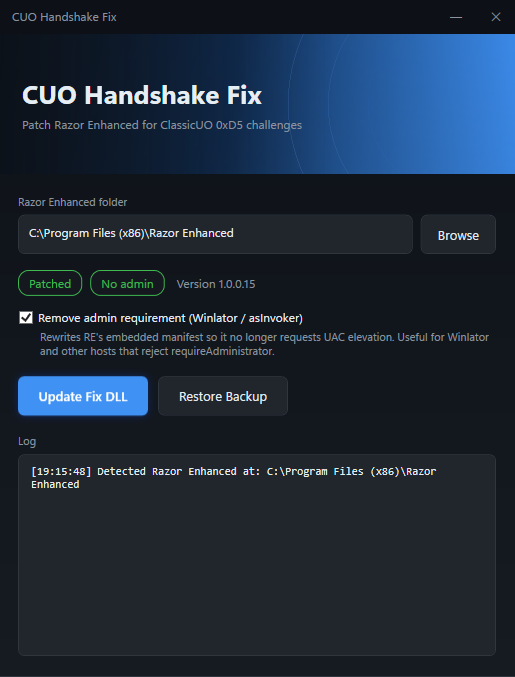

# CUO Handshake Fix Patcher

CUO Handshake Fix Patcher is a portable Windows utility for Razor Enhanced users who get disconnected after about four minutes when playing through ClassicUO Desktop. It updates Razor Enhanced’s handling of the `0xD5` server handshake and backs up `RazorEnhanced.exe` before patching it.

## Download

Open **Releases** on the GitHub repository and download `CuoHandshakePatcher-v1.0.0-win-x64.zip`. The portable build includes the .NET Desktop runtime. Compatibility covers **ClassicUO Desktop** with Razor Enhanced in plugin mode.

## Apply the patch

1. Close Razor Enhanced and ClassicUO.
2. Extract the ZIP and run `CuoHandshakePatcher.exe`. Keep the `Assets` folder next to the executable for the banner artwork.
3. Confirm the detected Razor Enhanced folder or select it with **Browse**.
4. Click **Apply Patch**.
5. Open Razor Enhanced from the same folder and select **Launch CUO**.

To undo the patch, close both apps, reopen the patcher, and select **Restore Backup**. The patcher restores the latest backup of `RazorEnhanced.exe` and removes `CuoHandshakeFix.dll`.

## Run Razor Enhanced without an administrator prompt (Winlator)

Winlator can have trouble launching Razor Enhanced when the executable requests administrator elevation. To remove that launch requirement, close Razor Enhanced and the game client, then open the patcher and select the Razor Enhanced folder. Check **Remove admin requirement (Winlator / asInvoker)** and click **Apply Patch**. You can do this even if the handshake fix is already installed.

The checkbox changes the Windows manifest inside `RazorEnhanced.exe` from `requireAdministrator` to `asInvoker`, so Razor Enhanced starts with the permissions of whatever launched it. The patcher displays **No admin** when it detects the updated manifest. The patcher itself still needs permission to write to the Razor Enhanced folder and may request elevation on Windows for a protected folder.

**Restore Backup** restores the latest saved executable, including its original elevation setting, and removes the handshake fix DLL.

[Build from source](BUILD.md) · [Third-party notices](THIRD-PARTY-NOTICES.md)
